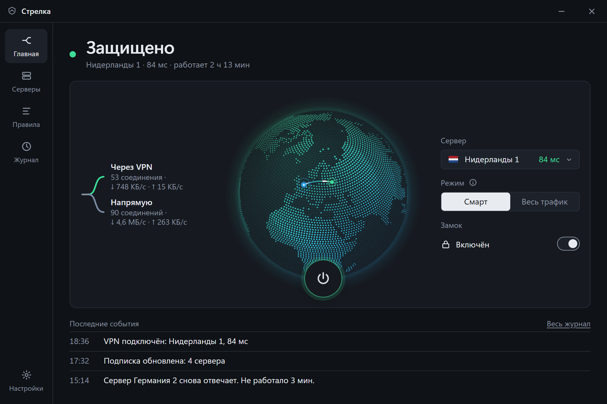

<div align="center">


# Стрелка

**Умный VPN для Windows: включается в один клик и сам знает, что пускать через VPN.**<br>
Списки заблокированного уже внутри — всё остальное идёт напрямую, на полной скорости.

[](https://github.com/MadBl1ss/strelka-app/releases/latest)
[](https://github.com/MadBl1ss/strelka-app/actions/workflows/ci.yml)
[](LICENSE)


[**Скачать**](https://github.com/MadBl1ss/strelka-app/releases/latest) · [Установка](#установка) · [Как устроена](#как-устроена) · [Сборка](#сборка-из-исходников) · [**English**](#english)

<br>

<picture>
  <source media="(prefers-color-scheme: light)" srcset=".github/assets/home-light.png">
  
</picture>

</div>

## Почему Стрелка

**Включил — и забыл.** Стрелка сама разводит трафик: что заблокировано —
через VPN, всё остальное — напрямую, без потери скорости. Ни правил
маршрутизации, ни geo-файлов, ни конфигов.

<table>
<tr>
<td width="50%" valign="top">

**Готовые списки**<br>
Тысячи сайтов, заблокированных и замедленных в России, уже внутри: YouTube,
Instagram, X, ChatGPT, Claude, Gemini. Списки обновляются сами, а Telegram,
WhatsApp, Discord и Spotify сразу идут через VPN.

</td>
<td width="50%" valign="top">

**Умный режим «Смарт»**<br>
Через VPN — только то, чему он нужен. Банки, Госуслуги и маркетплейсы идут
напрямую: не ругаются на зарубежный адрес и не тратят трафик подписки. Нужно
всё через VPN — один клик.

</td>
</tr>
<tr>
<td valign="top">

**Один клик — и подключено**<br>
Служба уже запущена, списки уже на диске, серверы перед стартом не
перебираются. Кнопка просто включает VPN: без долгого ожидания и без
запросов прав администратора.

</td>
<td valign="top">

**Плавно, без переподключений**<br>
Сервер, режим и правила меняются на лету — VPN не перезапускается. Мигнула
сеть — Стрелка отличит это от аварии и не будет тревожить зря.

</td>
</tr>
<tr>
<td valign="top">

**Трафик не протекает**<br>
Весь трафик системы идёт через TUN, а замок (kill switch) в сетевом экране
Windows не выпускает его мимо VPN, пока тот перезапускается. Упавший движок
поднимается за секунды.

</td>
<td valign="top">

**Понятно и открыто**<br>
Главная с первого взгляда отвечает «всё ли в порядке», уведомления — только
о настоящих проблемах и человеческими словами. Открытый код (MIT), без
аккаунтов, рекламы и телеметрии.

</td>
</tr>
</table>

## Возможности

### Раздельный туннель

- **Два режима.** «Смарт»: через VPN — только то, чему он нужен. «Весь
  трафик»: через VPN — всё, кроме локальной сети и списка «Напрямую». Чем
  они отличаются и когда какой включать, объясняет само окно — значок «i»
  рядом с переключателем.
- **Автосписки.** Сайты, заблокированные и замедленные в России: YouTube,
  Instagram, X, ChatGPT, Claude, Gemini и тысячи других. Движок обновляет их
  сам.
- **Свои списки** «Через VPN» и «Напрямую»: программы, сайты с поддоменами,
  точные имена, слова в адресе, IP-сети. Сразу после установки в первом —
  Telegram, WhatsApp, Discord, Spotify, Roblox и другие.
- **«Соединения сейчас»** — живая таблица: программа, адрес, путь. Перенести
  программу в другой список — одна кнопка.
- **«Куда пойдёт»** — проверка программы или сайта: через VPN или напрямую и
  по какому правилу.
- Правила применяются на лету, без переподключения.

### Защита

- **TUN.** Перехватывается весь трафик системы, а не только программы,
  которые слушаются системного прокси.
- **Замок (kill switch)** на Windows Filtering Platform. Пока VPN должен
  работать, в сеть выходят только движки и служба Стрелки; роутер, принтер
  и другие домашние устройства остаются доступны.
- **DNS и IPv6** идут через туннель; IPv6 можно и заблокировать, если у
  сервера его нет.
- Подписки и ключи хранит служба в `C:\ProgramData\Strelka`; обычный
  пользователь эту папку не читает.

### Надёжность

- **Служба Windows**: если VPN был включён, он поднимется вместе с
  компьютером — без окна и до входа в систему.
- **Диагнозы**: сервер не отвечает, все серверы не отвечают, нет интернета,
  нет сети, соединение нестабильно, движок перезапускается — каждый со своим
  текстом и советом.
- **Запасной сервер**: если выбранный перестал отвечать, Стрелка
  переключится на первый работающий из избранных. Порядок избранных
  задаёшь перетаскиванием.
- **Свои уведомления** с кнопками действий. Можно оставить только проблемы
  или выключить совсем; в полноэкранной игре или фильме они не появляются.
- **Проверка соединения по шагам**: сеть → интернет → DNS → VPN → сервер →
  сайт через VPN, с советом, что делать. **Отчёт для поддержки** — архив
  логов без ключей и ссылок подписок.

### Серверы и подписки

- Подписка по ссылке или отдельный сервер: **VLESS** (в том числе
  **REALITY** и **XHTTP**), **Trojan**, **Shadowsocks**, **Hysteria2**.
- Подходит и ссылка, которую бот провайдера даёт для Happ, v2RayTun, Hiddify,
  INCY и других приложений, и короткая ссылка на страницу подписки с
  кнопками «Добавить в …»: Стрелка достаёт из них адрес подписки.
  Зашифрованную ссылку Happ прочитать нельзя — для неё попроси у провайдера
  обычную.
- Остаток трафика и срок подписки с предупреждением, когда они на исходе.
- Пинг, полоска стабильности, избранное, поиск по имени, стране и адресу.
- Проверка всех серверов: у каждого свои 5 секунд, по 16 разом, сверху вниз,
  и на экране видно, какая подписка проверяется и сколько в ней отвечает.
  Работает и при выключенном VPN.
- Сервер меняется на лету, без перезапуска VPN.
- Подписки обновляются сами; HWID для панелей с лимитом устройств
  (Remnawave).

### Окно

- Tauri 2 и Svelte 5: лёгкое окно на системном WebView2.
- Главная отвечает на «всё ли в порядке» с первого взгляда: развилка «через
  VPN / напрямую» с живыми скоростями и глобус с лучом к стране сервера.
- Тёмная и светлая темы, значок в трее, автозапуск.
- **Обновления сами**: о новой версии скажет значок в окне; установщик
  проверяется по подписи.

## Установка

Нужна Windows 10 или 11, 64 бит.

1. Скачай `Strelka_<версия>_x64-setup.exe` со страницы
   [выпусков](https://github.com/MadBl1ss/strelka-app/releases/latest).
2. Запусти его. Windows SmartScreen может сказать «Windows защитила ваш
   компьютер»: у Стрелки пока нет подписи кода, поэтому издатель неизвестен.
   Нажми «Подробнее» → «Выполнить в любом случае».
3. Согласись на запрос прав администратора — он нужен один раз, чтобы
   поставить службу.
4. Откроется окно. Вставь ссылку на подписку (её даёт провайдер VPN) или на
   один сервер и нажми «Подключить».

Стрелка ставится для всех пользователей компьютера: окно — в
`C:\Program Files\Strelka`, служба `Strelka` запускается вместе с Windows.

### Обновление

Окно раз в несколько часов проверяет, нет ли новой версии; не ждать можно
кнопкой «Проверить сейчас» в «Настройках» → «О программе». Если версия есть —
над «Настройками» появляется значок «Обновить», а окошко с описанием
изменений откроется само один раз. «Установить сейчас» скачивает установщик,
проверяет его подпись и запускает.

- Windows спросит разрешения: установка — для всех пользователей.
- На минуту VPN и замок выключатся: вместе с окном обновляется служба. Потом
  VPN включится сам, если был включён.
- Подписки и настройки остаются на месте.

Можно и вручную: скачать свежий установщик и запустить поверх.

### Удаление

«Параметры» → «Приложения» → «Установленные приложения» → «Стрелка» →
«Удалить». Удаление останавливает службу, снимает фильтры замка и убирает
службу. Галочка «Удалить данные приложения» стирает и
`C:\ProgramData\Strelka` — подписки и ключи; без неё они остаются, и
переустановка их подхватит.

## Приватность

Стрелка не собирает телеметрию, не требует аккаунта и не показывает
рекламу. Кроме самих серверов VPN, она обращается вот куда:

| Куда | Зачем |
| --- | --- |
| Адрес подписки провайдера | Список серверов, остаток трафика и срок. Если панель ограничивает число устройств, вместе с запросом уходит HWID этого компьютера |
| GitHub | Проверка новой версии Стрелки; свежие автосписки, их скачивает движок |
| ip-api.com | Раз в сутки, мимо VPN: где этот компьютер, чтобы нарисовать луч на глобусе. Если выбрать город вручную в настройках, запросов нет |
| Google, Cloudflare, Microsoft | Короткие проверки связи: отличить «нет интернета» от «сервер не отвечает» |

## Как устроена

```
┌──────────────────────────────────────────────────────────┐
│ Окно — app/            Tauri 2 (Rust) + Svelte 5          │
│   экраны, трей, уведомления, обновление                   │
│   права обычного пользователя                             │
└────────────────────────────▲─────────────────────────────┘
                             │ JSON-RPC по именованному каналу
┌────────────────────────────▼─────────────────────────────┐
│ Служба strelkad — core/   Go, права системы               │
│   подписки, правила, режимы, сборка конфига               │
│   надзор за движками, диагнозы, журнал                    │
│   замок в сетевом экране (WFP)                            │
└──────────┬───────────────────────────────┬───────────────┘
           │ запускает и следит            │ Clash API, 127.0.0.1
┌──────────▼──────────┐   SOCKS   ┌────────▼──────────────┐
│ xray.exe            │◄──────────│ sing-box.exe          │
│ REALITY, XHTTP      │           │ TUN, маршруты, DNS    │
└─────────────────────┘           └───────────────────────┘
```

- **Служба переживает окно.** VPN, замок и проверки работают, когда окно
  закрыто или в систему ещё никто не вошёл.
- **Состояние приходит само.** Служба знает, когда упал движок или сменилась
  сеть, и сразу присылает окну новое состояние — окно ничего не опрашивает.
- **Движки — отдельные процессы** в Job Object: умрёт служба — умрут и они,
  сирот не остаётся. Так sing-box под GPL-3.0 не превращает код Стрелки в GPL,
  а движок можно обновить без пересборки.
- **Конфиг собирается, а не правится**: из профиля, правил и шаблона, при
  каждом изменении заново.

### Почему так быстро

- **Списки уже в сборке.** Перед стартом движку нечего скачивать; свежие
  версии списков он подтянет потом, в фоне.
- **Без перебора серверов.** VPN сразу идёт на выбранный сервер. Проверка
  всех серверов — отдельная кнопка, а на запасной переключает служба по
  диагнозу, а не по одному замеру.
- **Адреса серверов резолвятся напрямую**, а не через ещё не поднятый
  туннель.
- **Свободный порт каждый раз.** Порт и секрет для управления движком
  выбираются при запуске, так что зарезервированные Windows порты не мешают.
- **Служба уже работает** с нужными правами: клик по кнопке — просто команда
  ей. Готовность движка она узнаёт по событию, а не по таймеру.
- **Без перезапусков.** Сервер и режим переключаются через API движка, а
  списки правил — это файлы, которые движок перечитывает сам.

## Сборка из исходников

Нужны Go (версия — в `core/go.mod`), Node.js 24 и pnpm 11, Rust (stable) с
инструментами сборки Visual Studio (C++), Windows 10 или 11.

```powershell
cd app; pnpm install; cd ..
.\scripts\build-installer.ps1
# → app\src-tauri\target\release\bundle\nsis\Strelka_<версия>_x64-setup.exe
```

Скрипт собирает службу (`core/`), скачивает закреплённые версии движков с их
официальных страниц выпусков и сверяет суммы (`scripts/engines.json`,
`scripts/fetch-engines.ps1`), собирает окно (`app/`) и установщик NSIS. С
переменными `TAURI_SIGNING_PRIVATE_KEY` и `TAURI_SIGNING_PRIVATE_KEY_PASSWORD`
установщик ещё и подписывается для обновлений, а рядом пишется `latest.json`.

Выпуск собирает GitHub Actions (`.github/workflows/release.yml`) по тегу
`v<версия>`: черновик выпуска с установщиком, подписью и `latest.json`.
Версия одна на всё, в `app/package.json`; что изменилось — в
[CHANGELOG.md](CHANGELOG.md), раздел версии становится описанием обновления
в окне.

### Разработка

```powershell
cd core; go vet ./...; go test ./...           # служба
cd app; pnpm check; pnpm test; pnpm contrast   # окно: типы, логика, контраст цветов
cd app; pnpm dev                               # окно в браузере на заглушке службы
```

`pnpm dev` открывает окно на заглушке: `?mock=<сценарий>` показывает
готовые состояния (`ok`, `off`, `server_down`, `no_internet`, `many` и
другие), `&theme=light` — светлую тему. Служба в режиме разработки:
`go run ./cmd/strelkad run --data ../.dev --engines ../engines --no-tun` —
вместо адаптера локальный прокси на `127.0.0.1:20808`, без прав
администратора.

## Благодарности и лицензии

Стрелка распространяется под лицензией [MIT](LICENSE). Движки запускаются
отдельными процессами без изменений и ставятся вместе со Стрелкой со своими
лицензиями (в папке установки — `licenses\`, там же `SOURCES.txt` с адресами
исходников именно тех версий, что внутри):

- [sing-box](https://github.com/SagerNet/sing-box) — GPL-3.0-or-later;
  полный текст — `licenses\GPL-3.0.txt`;
- [Xray-core](https://github.com/XTLS/Xray-core) — MPL-2.0.

Ещё Стрелка опирается на:

- [itdoginfo/allow-domains](https://github.com/itdoginfo/allow-domains) —
  списки заблокированных в России сайтов;
- [Twemoji](https://github.com/twitter/twemoji) — флаги стран (CC-BY 4.0);
- [ip-api.com](https://ip-api.com) — место компьютера для глобуса.

Версии движков и откуда они берутся — `scripts/engines.json`.

<br>

---

<div align="center">

<a id="english"></a>

# Strelka

**A smart VPN for Windows: one click to connect, and it knows what to send through the VPN.**<br>
Lists of blocked sites are built in — everything else goes direct, at full speed.

[**Download**](https://github.com/MadBl1ss/strelka-app/releases/latest) · [Install](#install) · [How it works](#how-it-works) · [Build](#building-from-source) · [**Русский**](#стрелка)

</div>

*Strelka* is Russian for a railway switch: one stream of traffic splits onto
two tracks, "through the VPN" and "direct". The interface is in Russian; the
project targets users in Russia, where many sites are blocked or throttled
while local banks and services refuse foreign IP addresses.

## Why Strelka

**Turn it on and forget it.** Strelka splits the traffic itself: what is
blocked goes through the VPN, everything else goes direct, with no loss of
speed. No routing rules, no geo files, no configs.

<table>
<tr>
<td width="50%" valign="top">

**Lists out of the box**<br>
Thousands of sites blocked or throttled in Russia are already inside:
YouTube, Instagram, X, ChatGPT, Claude, Gemini. The lists update
themselves, and Telegram, WhatsApp, Discord and Spotify go through the VPN
from the start.

</td>
<td width="50%" valign="top">

**The Smart mode**<br>
Only what needs the VPN goes through it. Banks, government services and
marketplaces go direct: they don't object to a foreign address and don't eat
your plan's traffic. Need everything through the VPN — one click.

</td>
</tr>
<tr>
<td valign="top">

**One click and you're connected**<br>
The service is already running, the lists are already on disk, servers are
not probed before the start. The button just turns the VPN on: no long wait
and no admin prompts.

</td>
<td valign="top">

**Smooth, no reconnects**<br>
Server, mode and rules change on the fly — the VPN does not restart. The
network blinked — Strelka tells that from an outage and doesn't raise a
false alarm.

</td>
</tr>
<tr>
<td valign="top">

**Nothing leaks**<br>
All system traffic goes through TUN, and the kill switch in the Windows
firewall keeps it from slipping past the VPN while it restarts. A crashed
engine is back in seconds.

</td>
<td valign="top">

**Clear and open**<br>
Home tells you at a glance whether everything is fine; notifications come
only for real problems, in plain words. Open source (MIT), no account, no
ads, no telemetry.

</td>
</tr>
</table>

## Features

### Split tunnelling

- **Two modes.** *Smart*: only what needs the VPN goes through it. *All
  traffic*: everything goes through the VPN except the local network and the
  "Direct" list. The window itself explains the difference and when to pick
  which — the "i" next to the switch.
- **Auto-lists** of sites blocked or throttled in Russia: YouTube, Instagram,
  X, ChatGPT, Claude, Gemini and thousands more. The engine keeps them fresh.
- **Your own lists**, "Through VPN" and "Direct": programs, domains with
  subdomains, exact names, keywords, IP networks. Out of the box the first
  one holds Telegram, WhatsApp, Discord, Spotify, Roblox and others.
- **Live connections**: program, address, route. Moving a program to the
  other list is one button.
- **"Where will it go"**: check a program or a site — through the VPN or
  direct, and by which rule.
- Rules apply on the fly, without reconnecting.

### Protection

- **TUN**: all system traffic is captured, not only the programs that honour
  the system proxy.
- **Kill switch** on the Windows Filtering Platform. While the VPN should be
  up, only Strelka's engines and service may reach the network; the router,
  printers and other home devices stay reachable.
- **DNS and IPv6** go through the tunnel; IPv6 can be blocked instead if the
  server has none.
- Subscriptions and keys are kept by the service in `C:\ProgramData\Strelka`,
  which a regular user cannot read.

### Reliability

- **A Windows service**: if the VPN was on, it comes back with the computer —
  without the window and before anyone signs in.
- **Diagnoses**: server down, all servers down, no internet, no network,
  unstable connection, engine restarting — each with its own text and advice.
- **Fallback server**: if the selected server stops answering, Strelka
  switches to the first working one among your favourites. Their order is
  set by dragging.
- **Its own notifications** with action buttons. Keep only problems or turn
  them off; they never show up over a full-screen game or film.
- **Step-by-step connection check**: network → internet → DNS → VPN → server
  → a site through the VPN, with advice on what to do. **A support report**:
  an archive of logs without keys or subscription links.

### Servers and subscriptions

- A subscription link or a single server: **VLESS** (including **REALITY**
  and **XHTTP**), **Trojan**, **Shadowsocks**, **Hysteria2**.
- The link a provider's bot makes for Happ, v2RayTun, Hiddify, INCY and
  other apps works too, and so does a short link to a subscription page with
  "Add to …" buttons: Strelka finds the subscription behind them. A link
  Happ has encrypted cannot be read; ask the provider for a plain one.
- Traffic left and subscription term, with a warning before they run out.
- Ping, a stability meter, favourites, search by name, country and address.
- Testing every server: each gets its own 5 seconds, 16 at a time, top to
  bottom, and the window shows which subscription is being tested and how
  many of its servers answer. Works with the VPN off too.
- The server changes on the fly, without restarting the VPN.
- Subscriptions update themselves; HWID for panels with a device limit
  (Remnawave).

### The window

- Tauri 2 and Svelte 5: a light window on the system WebView2.
- Home answers "is everything fine" at a glance: a fork "through VPN /
  direct" with live speeds and a globe with a beam to the server's country.
- Dark and light themes, a tray icon, autostart.
- **Updates itself**: an icon in the window tells you about a new version;
  the installer is verified by its signature.

## Install

Windows 10 or 11, 64-bit.

1. Download `Strelka_<version>_x64-setup.exe` from the
   [releases](https://github.com/MadBl1ss/strelka-app/releases/latest) page.
2. Run it. Windows SmartScreen may say "Windows protected your PC": Strelka
   has no code signing certificate yet, so the publisher is unknown. Click
   "More info" → "Run anyway".
3. Accept the administrator prompt — it is needed once, to install the
   service.
4. The window opens. Paste a subscription link (your VPN provider gives you
   one) or a single server link and press «Подключить» (Connect).

Strelka is installed for all users: the window goes to
`C:\Program Files\Strelka`, and the `Strelka` service starts with Windows.

**Updates**: the window checks for a new version every few hours (or at once:
Settings → О программе → «Проверить сейчас») and shows an
«Обновить» (Update) icon above Settings. The installer is downloaded, its
signature checked, and it runs; the VPN and the kill switch are off for about
a minute while the service is updated and come back on by themselves.
Subscriptions and settings stay.

**Uninstall**: Settings → Apps → Installed apps → Стрелка → Uninstall. The
service is stopped, the kill switch filters are removed. The "Delete app
data" box also wipes `C:\ProgramData\Strelka` — subscriptions and keys;
without it they stay, and a reinstall picks them up.

## Privacy

No telemetry, no account, no ads. Besides the VPN servers themselves,
Strelka talks to:

| Where | Why |
| --- | --- |
| Your provider's subscription URL | The server list, traffic left and term. If the panel limits devices, this computer's HWID goes with the request |
| GitHub | Checking for a new Strelka version; fresh auto-lists, downloaded by the engine |
| ip-api.com | Once a day, outside the VPN: where this computer is, to draw the beam on the globe. Pick a city by hand in Settings and there are no requests |
| Google, Cloudflare, Microsoft | Short connectivity probes: telling "no internet" from "server not answering" |

## How it works

```
┌──────────────────────────────────────────────────────────┐
│ Window — app/          Tauri 2 (Rust) + Svelte 5          │
│   screens, tray, notifications, updates                   │
│   runs as the regular user                                │
└────────────────────────────▲─────────────────────────────┘
                             │ JSON-RPC over a named pipe
┌────────────────────────────▼─────────────────────────────┐
│ Service strelkad — core/   Go, runs as SYSTEM             │
│   subscriptions, rules, modes, config generation          │
│   engine supervision, diagnoses, journal                  │
│   kill switch in the Windows firewall (WFP)               │
└──────────┬───────────────────────────────┬───────────────┘
           │ starts and watches            │ Clash API, 127.0.0.1
┌──────────▼──────────┐   SOCKS   ┌────────▼──────────────┐
│ xray.exe            │◄──────────│ sing-box.exe          │
│ REALITY, XHTTP      │           │ TUN, routing, DNS     │
└─────────────────────┘           └───────────────────────┘
```

- **The service outlives the window.** The VPN, the kill switch and the
  probes keep working while the window is closed or nobody has signed in.
- **State is pushed, not polled.** The service knows the moment an engine
  dies or the network changes and sends the window the new state at once.
- **Engines are separate processes** in a Job Object: if the service dies,
  they die with it, no orphans. This also keeps sing-box's GPL-3.0 from
  extending to Strelka's code and lets an engine be updated without a
  rebuild.
- **The config is generated, not edited**: from the profile, the rules and a
  template, anew on every change.

### Why it is fast

- **The lists ship with the build.** The engine has nothing to download
  before it starts; fresh versions of the lists come later, in the
  background.
- **No server probing.** The VPN goes straight to the selected server.
  Testing all servers is a separate button, and the service switches to a
  fallback on a diagnosis, not on a single probe.
- **Server addresses resolve directly**, not through a tunnel that is not up
  yet.
- **A free port every time.** The port and secret for controlling the engine
  are picked at start, so ports reserved by Windows don't get in the way.
- **The service is already running** with the rights it needs: a click is
  just a command to it. It learns that the engine is ready from an event,
  not a timer.
- **No restarts.** Server and mode switch through the engine's API, and rule
  lists are files the engine re-reads by itself.

## Building from source

You need Go (version in `core/go.mod`), Node.js 24 and pnpm 11, Rust (stable)
with the Visual Studio C++ build tools, Windows 10 or 11.

```powershell
cd app; pnpm install; cd ..
.\scripts\build-installer.ps1
# → app\src-tauri\target\release\bundle\nsis\Strelka_<version>_x64-setup.exe
```

The script builds the service (`core/`), downloads the pinned engine versions
from their official release pages and verifies their checksums
(`scripts/engines.json`, `scripts/fetch-engines.ps1`), builds the window
(`app/`) and the NSIS installer. With `TAURI_SIGNING_PRIVATE_KEY` and
`TAURI_SIGNING_PRIVATE_KEY_PASSWORD` set, the installer is also signed for
updates and `latest.json` is written next to it.

Releases are built by GitHub Actions (`.github/workflows/release.yml`) on a
`v<version>` tag: a draft release with the installer, its signature and
`latest.json`. There is one version for everything, in `app/package.json`;
changes go to [CHANGELOG.md](CHANGELOG.md), whose section for a version
becomes the update notes in the window.

### Development

```powershell
cd core; go vet ./...; go test ./...           # service
cd app; pnpm check; pnpm test; pnpm contrast   # window: types, logic, colour contrast
cd app; pnpm dev                               # the window in a browser on a mock service
```

`pnpm dev` runs the window against a mock: `?mock=<scenario>` shows ready-made
states (`ok`, `off`, `server_down`, `no_internet`, `many` and more),
`&theme=light` the light theme. The service in development mode:
`go run ./cmd/strelkad run --data ../.dev --engines ../engines --no-tun` — a
local proxy on `127.0.0.1:20808` instead of the adapter, no admin rights
needed.

## Credits and licenses

Strelka is licensed under [MIT](LICENSE). The engines run as separate,
unmodified processes and ship with Strelka under their own licenses (see
`licenses\` in the install folder, with `SOURCES.txt` pointing at the source
of exactly the versions inside):

- [sing-box](https://github.com/SagerNet/sing-box) — GPL-3.0-or-later; full
  text in `licenses\GPL-3.0.txt`;
- [Xray-core](https://github.com/XTLS/Xray-core) — MPL-2.0.

Strelka also relies on:

- [itdoginfo/allow-domains](https://github.com/itdoginfo/allow-domains) —
  lists of sites blocked in Russia;
- [Twemoji](https://github.com/twitter/twemoji) — country flags (CC-BY 4.0);
- [ip-api.com](https://ip-api.com) — the computer's location for the globe.

Engine versions and where they come from: `scripts/engines.json`.
